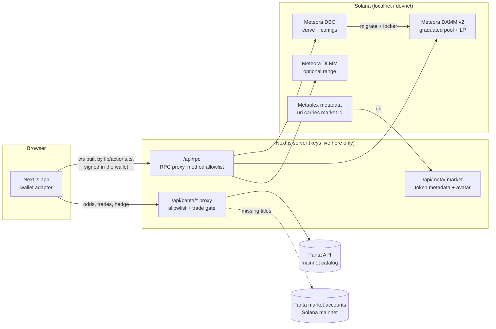

# Catalyst

**Launch tokens on what happens next.** Catalyst is a token launchpad on Meteora's Dynamic Bonding Curve (DBC). Each launch can be tied to a live prediction market on [Panta](https://panta.market). Traders see the crowd's odds next to the price. The creator's tokens and LP stay locked until the event resolves. Curves graduate into Meteora DAMM v2 pools.

- **Launchpad:** four curve presets with different price shapes, fee schedules and lock rules. They are real on-chain DBC configs.
- **Preset marketplace:** anyone can publish a preset as a shared DBC config. The publisher becomes its `feeClaimer` and earns the partner share of every launch on it.
- **Event data:** the Panta market's question, odds and resolution date appear on the token page. An optional hedge lets holders buy the outcome they are worried about.
- **After graduation:** trading on the DAMM v2 pool, the locked LP positions with their claimable fees, and an optional Meteora DLMM range next to the pool. Trades route to whichever pool pays more.

> Status: runs end to end on a local validator with cloned mainnet programs. Devnet deployment is in progress. Nothing is deployed to mainnet. Real-money Panta trading is switched off (see [Safety](#safety)).

## How it works



The launch lifecycle:

1. **Pick an event.** The launch page lists open Panta markets from `/api/panta/markets/`.
2. **Pick a curve.** Event Horizon builds a fresh DBC config for this launch, because its lock dates depend on the event's resolution time. The other presets reuse a shared, published config.
3. **Launch.** The creator signs the config creation (Event Horizon only), then the pool plus their first buy (`createConfigAndPoolWithFirstBuy` / `createPoolWithFirstBuy`). The Metaplex `uri` is `https://<app>/api/meta/<pantaMarketId>?n=..&s=..`, so the link to the event is stored on-chain.
4. **Trade on the curve.** `swapQuote2` / `swap2` in `PartialFill` mode, so the last buy before graduation is filled exactly and the rest refunded.
5. **Graduate.** Anyone can press the button once the curve is full. It creates the vesting locker when the preset has creator vesting, then calls `migrateToDammV2`.
6. **After graduation.** Trades go to DAMM v2 (`getQuote2` / `swap2`), or to DLMM if a pair is open and it quotes more. The LP positions DBC minted keep their locks: permanent, or vesting that starts when the event resolves. They still earn fees, which holders can claim (`claimPositionFee2`). Creator and preset-author fees from the curve are claimable via `claimCreatorTradingFeeToReceiver` / `claimPartnerTradingFeeToReceiver`.

7. **DLMM range (optional).** Any holder can open a token/SOL DLMM pair (`createCustomizablePermissionlessLbPair2`). Its active bin is set to the DAMM v2 pool's current price, with 1% bins. They can then add a Spot range of ±10 bins (`initializePositionAndAddLiquidityByStrategy`). The trade box quotes both pools (`getQuote2` vs `swapQuote`) and sends the order to the one that pays more.

**Launch discovery needs no database.** Every Catalyst config sets `leftoverReceiver` to the platform wallet. The home page finds configs with `getPoolConfigsByOwner` (DBC filters on that field), then pools with `getPoolsByConfig`. Each pool's Panta market comes from its Metaplex `uri`. See `lib/launches.ts`.

## The presets

All four presets are built with `buildCurveWithLiquidityWeights` (16 price segments). Tests check each one with DBC's own `validateConfigParameters` at production scale and at devnet scale (`lib/presets.test.ts`).

| Preset | Curve | Curve fees | After graduation (DAMM v2) |
|---|---|---|---|
| **Event Horizon** (event-linked) | 30 → 300 SOL mcap, depth grows 1.25× per segment | Anti-sniper 50% → 1% over 15 min (exponential) + volatility fee; creator gets 50% of fees; creator's first buy skips the ramp | 2% fee falling to 0.25% as market cap grows 10× (`FeeMarketCapSchedulerExponential`, runs until the event resolves). 90% of LP vests to the creator starting at resolution; 10% locked forever. Creator's 10% token allocation also unlocks only after resolution, then vests over 30 days. |
| **Flat** | 50 → 75 SOL: early and late buyers pay about the same | 1% flat | Compounding pool (half of LP fees reinvested). 50% LP locked forever, 50% to creator. |
| **Long Curve** | 5 → 5000 SOL with even depth | 20% → 1% over an hour (linear) + volatility fee | 50% LP locked forever (20% author, 30% creator), 50% to creator |
| **Parabolic** | 20 → 400 SOL, depth thins 20% per segment | 30% → 1.5% over 10 min (exponential) + volatility fee | All LP locked forever |

The lock period is capped at DBC's 2-year maximum. Market caps are multiplied by `NEXT_PUBLIC_SCALE`. The default off mainnet is `0.01`, where a curve graduates on about 1 SOL. The devnet deploy uses `0.005`, so a curve graduates on about 0.5 SOL.

## Panta integration

The app reaches Panta only through `app/api/panta/[...path]/route.ts`. It forwards an allowlist of paths (catalog, market detail, trades, positions, primary-order quote/build/submit/verify, claim build). Account and key management paths are never exposed. Market creation is exposed only with `PANTA_ALLOW_CREATE=1`, which is off.

| Where | Panta call | What it's for |
|---|---|---|
| Launch page | `GET categories/`, `GET markets/` | Pick the event a token is about (open markets only) |
| Home, token page | `GET markets/{id}/` | Title, YES/NO odds, resolution date. The resolution date drives Event Horizon's lock dates. |
| Token page | `GET markets/{id}/trades/` | Trade tape next to the token chart |
| Hedge box | `POST primaryorderquote/` → `build` → `submit` → `verify`, `GET positions/` | Buy YES/NO on the event from the token page |

Keys: `PANTA_API_KEY_LIVE` (a `pk_live_` key) serves the mainnet catalog. `PANTA_API_KEY` (a `pk_test_` key) serves Panta's sandbox. `PANTA_MODE=sandbox` forces the sandbox key. `PANTA_MODE=mock`, or having no key at all, serves the built-in demo data. The footer always says which source is in use, and non-live data is labelled on the page.

## Safety

- The Panta API key is read only on the server (`lib/panta.ts`), never through `NEXT_PUBLIC_*`.
- **Trade gate:** with a `pk_live_` key, any call past a quote (`primaryorderbuild/submit/verify`, `claim/build`, `trades`) returns 403 unless `PANTA_ALLOW_TRADE=1`. It is unset in every environment we run. On live markets the hedge box shows a quote, or a link to panta.market when the market is past its primary sale.
- **RPC key:** the deployed app talks to Solana through `/api/rpc`. That route forwards an allowlist of JSON-RPC methods to the provider URL in `HELIUS_DEVNET_RPC_URL`, so the key is never sent to the browser. Confirmations poll over HTTP instead of using a websocket.
- Throwaway keypairs for scripts live in `.keys/` (gitignored). Wallets in the app are the user's own, or a burner wallet on localnet only (`NEXT_PUBLIC_BURNER=1`).

## Run it locally

Prerequisites: [Bun](https://bun.sh) ≥ 1.3 and the Solana CLI (for `solana-test-validator`).

```bash
bun install

# 1. Local validator with DBC, DAMM v2, DLMM, Metaplex, Locker and their config/authority accounts cloned from mainnet
./scripts/localnet.sh            # keep running; it resets on each start

# 2. Publish the static presets and seed demo launches (one graduated)
NETWORK=localnet RPC_URL=http://127.0.0.1:8899 ORIGIN=http://localhost:3000 bun scripts/seed.ts

# 3. App
cat > .env.development.local <<'EOF'
NEXT_PUBLIC_RPC_URL=http://127.0.0.1:8899
NEXT_PUBLIC_NETWORK=localnet
NEXT_PUBLIC_BURNER=1
EOF
bun run dev                      # http://localhost:3000; use "Get test SOL" in the header
```

Without Panta keys the app uses the built-in demo data. To use real data, put `PANTA_API_KEY_LIVE=pk_live_...` and/or `PANTA_API_KEY=pk_test_...` in `.env.local`.

### Tests

```bash
bun run test                                          # presets, curve math, Panta client + proxy gate, launch metadata
RPC_URL=http://127.0.0.1:8899 bun scripts/e2e.ts      # full on-chain lifecycle against the real programs
```

`scripts/e2e.ts` calls the same `lib/actions.ts` functions as the UI. It:
- publishes a preset and launches on it;
- launches an Event Horizon token and checks the Panta id round-trips through Metaplex;
- buys to graduation, runs the locker and migration, then trades on DAMM v2;
- claims creator and author fees;
- checks that the LP locks match the preset (90% vesting from resolution, 10% permanent);
- claims LP fees from the locked positions;
- opens a DLMM pair at the DAMM v2 price, adds a range, checks both pools quote within 10% of each other, and trades on DLMM.

### Environment

| Variable | Side | Default | Purpose |
|---|---|---|---|
| `NEXT_PUBLIC_RPC_URL` | client | devnet | Cluster for DBC / DAMM v2 / DLMM. `/api/rpc` uses the server-side proxy. |
| `HELIUS_DEVNET_RPC_URL` | server | – | Upstream for `/api/rpc` (contains the provider key) |
| `NEXT_PUBLIC_NETWORK` | client | `devnet` | `localnet` / `devnet`; picks preset configs from `lib/deployments.json` |
| `NEXT_PUBLIC_SCALE` | client | `0.01` | Market-cap multiplier for presets |
| `NEXT_PUBLIC_PLATFORM` | client | `JE5w…uoF` | Platform wallet: `leftoverReceiver` on all configs, used for discovery |
| `NEXT_PUBLIC_BURNER` | client | off | Burner wallet (localnet only) |
| `NEXT_PUBLIC_PANTA_RPC_URL` | client | mainnet-beta | RPC for signing Panta orders (only used if trading is enabled) |
| `PANTA_API_KEY_LIVE` | server | – | `pk_live_` key for the mainnet catalog |
| `PANTA_API_KEY` | server | – | `pk_test_` sandbox key |
| `PANTA_MODE` | server | auto | `mock` / `sandbox` to override |
| `PANTA_RPC_URL` | server | mainnet-beta | RPC for reading Panta market accounts |
| `PANTA_ALLOW_TRADE` | server | off | Allow real-money order building with a live key |
| `PANTA_ALLOW_CREATE` | server | off | Expose market creation paths |

## Code map

```
lib/presets.ts      the four DBC presets (curve, fees, migration, LP split, vesting)
lib/actions.ts      every on-chain action as unsigned tx steps: launch, trade, graduate, DAMM v2 trade/LP, DLMM pair/range/swap, fee claims, publish preset
lib/launches.ts     discovery (config → pools → Metaplex), metadata uri <-> market id
lib/curve.ts        price curve sampling for charts
lib/panta.ts        typed Panta client, allowlist, trade gate, catalog clean-up
lib/panta-mock.ts   offline demo data
app/                pages: launches, launch flow, token page, presets; API: panta proxy, RPC proxy, token metadata
scripts/            localnet, seed, e2e
```

## Known limitations

- **Panta API behaviour we work around.** Seen with a `pk_live_` key in September 2026:
  - Market list rows often have empty `title` and `description`. We read the question and resolution rule from the market's on-chain account. Markets with no on-chain account are hidden.
  - `nextCursor` pages repeat earlier rows, and a page holds at most 50 rows. We merge the unfiltered, `status=primary` and `status=secondary` views and remove duplicates. Markets beyond those views are not listed.
  - `phase=` has no effect as a filter. We filter open markets ourselves.
  - List and detail can disagree for the same market. For example, the list shows `secondary` with prices while the detail shows `primary` with null prices. When the detail has no prices, we use the list row's phase and prices.
  - `markets/{id}/trades/` returned no rows, even for markets with volume, so the trade tape is often empty.
  - The hedge only buys during a market's primary sale (`primaryorder*`). The open markets we saw were all past it, so on live data the hedge box shows odds and a link to panta.market.
  - `pk_test_` keys return one sandbox market with ISO dates and no `avgPrice`. The client accepts both formats.
- **Network.** Meteora programs run on localnet (cloned from mainnet) or devnet. Panta runs on mainnet. The event data is real, but tokens launched on devnet are test tokens.
- **Scale.** Off mainnet, presets run at 0.5–1% of production market caps, so graduation is reachable with faucet SOL.
- **Discovery.** It uses `getProgramAccounts` through the DBC SDK, so it needs an RPC that allows it. The public devnet RPC was timing out on account reads while we built this, so the deploy uses a Helius devnet endpoint behind `/api/rpc`.
- **RPC proxy.** It has a method allowlist but no per-IP rate limit.

---

Prediction data: Panta. Curves and graduation: Meteora DBC + DAMM v2.
